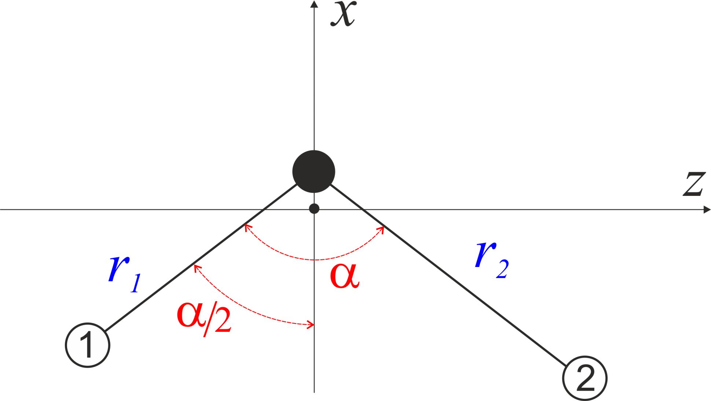

H2S: a compact SPAR kinetic operator
====================================

This example uses a bent triatomic in the ``BISECT-Z`` frame with valence
coordinates ``R-ALPHA``. It illustrates an explicit kinetic-function
library and its relationship to TROVE's built-in compact XY2 operator.
A rigid reference configuration fixes the expansion reference; the molecule
still vibrates in all three internal coordinates.

Download the complete input:
:download:`H2S_EKE_basic-functions_step1.inp <input/H2S_EKE_basic-functions_step1.inp>`.
It contains nuclear masses, equilibrium geometry, potential coefficients,
and dipole parameters. No external surface file is needed for the step-1
energy calculation. The dipole parameters are retained from the existing
example; intensities are outside this tutorial's validation scope.

Coordinates and model
---------------------

   Valence bond lengths and bond angle in the bisector embedding.

The masses occur in S, H, H order. The two hydrogen masses must agree for
this XY2 symmetry model. Distances are in angstroms; the equilibrium angle
and bending integration bounds use the explicit ``DEG`` conversion.
Function evaluation uses radians.

The input selects ``KINETIC_XY2_EKE_BISECT_COMPACT_RIGID`` and ``compact``.
Its finite analytic KEO uses the function labels below. ``KinOrder 13`` is
needed by this implementation to accommodate its 13 pseudopotential terms;
it is not a 13th-order Taylor approximation to this exact operator.

Function library
----------------

.. literalinclude:: input/H2S_EKE_basic-functions_step1.inp
   :language: text
   :start-at: BASIC-FUNCTION
   :end-at: END

For either stretch, indices 1 and 2 denote inverse first and second powers
of the bond length. The bending indices are:

.. list-table:: Bending library for the compact XY2 operator
   :class: wrap-table
   :header-rows: 1

   * - Index
     - Function
   * - 0
     - 1 (implicit)
   * - 1
     - :math:`\sin\alpha`
   * - 2
     - :math:`\cos\alpha`
   * - 3
     - :math:`\csc\alpha`
   * - 4
     - :math:`\cot^2(\alpha/2)`
   * - 5
     - :math:`\csc^2(\alpha/2)`
   * - 6
     - :math:`\sec^2(\alpha/2)`
   * - 7
     - :math:`\cos^2(\alpha/2)`

The seven-function order is essential. The earlier manual's six-function
list and old four-field constructor records are incompatible with the
current input reader and built-in coefficient mapping. See :doc:`spar_input`.

For example, writing :math:`\mu^{-1}=m_{\rm S}^{-1}+m_{\rm H}^{-1}`,
the vibrational metric before the energy-unit conversion includes

.. math::

   G^{\rm vib}_{11}=G^{\rm vib}_{22}=\mu^{-1},\qquad
   G^{\rm vib}_{12}=\frac{\cos\alpha}{m_{\rm S}},

.. math::

   G^{\rm vib}_{13}=-\frac{\sin\alpha}{m_{\rm S}r_2},\qquad
   G^{\rm vib}_{23}=-\frac{\sin\alpha}{m_{\rm S}r_1},

.. math::

   G^{\rm vib}_{33}=\mu^{-1}(r_1^{-2}+r_2^{-2})
       -\frac{2\cos\alpha}{m_{\rm S}r_1r_2}.

Thus the single tuple ``0 0 2`` represents the angular dependence of
:math:`G^{\rm vib}_{12}`, whereas ``0 1 1`` represents that of
:math:`G^{\rm vib}_{13}`. Rotational, Coriolis, and pseudopotential terms
use the same library with their own coefficients and component indices.

Small basis
-----------

.. literalinclude:: input/H2S_EKE_basic-functions_step1.inp
   :language: text
   :start-at: BASIS
   :end-at: END

The first integer on each vibrational row identifies its contraction group;
the repeated 1 for the stretches is intentional. The mode order follows the
rows. ``automatic`` selects the explicit kinetic functions. Both primitive
and contracted polyad cutoffs are 4. The resulting levels are useful for
implementation comparisons, not converged spectroscopy.

Run and compare
---------------

Place the input in a fresh working directory and run it using your TROVE
executable, for example in a Unix-like shell::

   /path/to/j-trove.x < H2S_EKE_basic-functions_step1.inp > h2s.out

See :doc:`compile` for Windows redirection. Check for ``End of TROVE`` and
inspect the eigenvalue description files. For a controlled comparison,
repeat with only the complete ``BASIC-FUNCTION`` block removed. The chosen
compact KEO then supplies its built-in library. All other model and numerical
settings must stay identical, and the two runs must use separate directories.

Agreement tests the explicit constructor against the built-in library.
It does not independently establish the correctness of the complete KEO,
potential, or convergence. An independent operator check and a nonzero-J
comparison provide additional evidence; their scope is recorded with the
validation results accompanying this example.

Staged calculation and checkpoint import
----------------------------------------

A nonzero-J calculation requires the contracted matrix elements from the
J=0 calculation. Keep the step-1 files, add ``model J=0`` to ``CONTRACTION``,
and run ``CONTROL STEP 2`` at ``Jrot 0`` to convert the matrix elements.
Then run ``CONTROL STEP 3`` at ``Jrot 1``. In these two later inputs, add
the following override after the ``CONTROL`` block::

   CHECK_POINT
     basis_set save
   END

This regenerates the primitive basis. With the tested revision and build,
reading the step-1 ``prim_bset.chk`` instead failed in ``BasisRestore``
with an input-record-length error. The override completed the staged
workflow without changing the basis specification. Step 2 terminates with
``...done!`` after writing the ``j0_matelem*.chk`` files; steps 1 and 3
terminate with ``End of TROVE``.

To test the external KEO interface, copy the step-1 ``kinetic.chk`` to a
fresh directory, remove the complete built-in ``KINETIC`` block from the
input, retain ``BASIC-FUNCTION KINETIC``, and add after ``CONTROL``::

   CHECK_POINT
     kinetic read with_modes
   END

The absence of ``KINETIC COMPACT`` matters: that option forces a rebuild
in this revision even when ``READ`` is requested. The external-reader
example can then follow the same later stages. See :doc:`spar_checkpoints`.

Reproducible validation
-----------------------

From the repository root, run the included Python script with the TROVE
executable and a work directory that does not yet exist::

   python test/spar_h2s/run_comparison.py /path/to/j-trove.x /path/to/new-workdir

The script generates all nine inputs: three stages for the explicit
library, built-in library, and external-checkpoint variants. It preserves
their inputs, logs, and checkpoints, and writes ``run-summary.json``.
Compiler runtime libraries must be available in the calling environment.

The reference run used revision ``7831d55`` with Intel ifx 2025.3.2 and
sequential MKL 2025.3 on Windows. The input uses the supplied potential
parameters without refitting. The following results were obtained:

.. list-table:: Numerical comparison
   :class: wrap-table
   :header-rows: 1

   * - Check
     - Result
   * - J=0 state count
     - 35
   * - J=1 state count
     - 105
   * - Explicit versus built-in libraries
     - Identical printed energies at both J values
   * - External-checkpoint energies, largest difference
     - :math:`2.37\times10^{-11}\,\mathrm{cm}^{-1}`
   * - KEO record counts: vibrational / rotational / Coriolis / pseudopotential
     - 11 / 14 / 4 / 13
   * - Independent Cartesian vibrational-metric check
     - Maximum absolute discrepancy :math:`7.42\times10^{-11}` in the unscaled metric

The comparison tolerance for energies is :math:`10^{-8}\,\mathrm{cm}^{-1}`.
The metric check obtains coordinate gradients by central Cartesian finite
differences at three non-singular geometries and compares their mass-weighted
products with the checkpoint reconstruction. Its absolute tolerance is
:math:`2\times10^{-8}`. It uses the unit-conversion constants and default-real
literal precision of the baseline ``accuracy.f90``. This independently tests
the vibrational metric; the rotational and pseudopotential comparisons are
checks between implementations of the same model.

For orientation, the lowest J=0 energy is
:math:`3291.158747830407\,\mathrm{cm}^{-1}` relative to the potential's zero,
and the lowest J=1 energy is :math:`3304.905173544121\,\mathrm{cm}^{-1}`
on the same scale. These are regression values for this small basis,
not converged or experimentally validated term values. Mass-factorised
checkpoints, endpoint singularities, and dipole intensities require separate
examples and are not covered by these checks.
